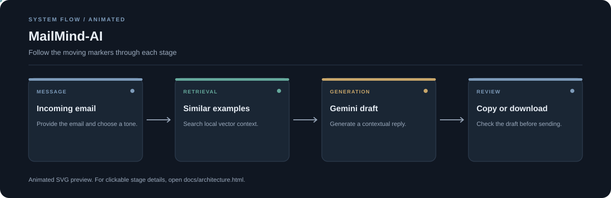

# MailMind AI

**Email replies shaped by your context and the tone you choose.**

MailMind is a Streamlit app that finds similar example emails with a local vector store, then uses the retrieved context and Google Gemini to draft a reply.

**Stack:** Python, Streamlit, Sentence Transformers, ChromaDB, Gemini



## What it does

- Accepts an email or message as input.
- Lets you choose a reply tone, including formal, friendly, apologetic, professional, appreciative, assertive, sympathetic, and informative.
- Retrieves similar examples from ChromaDB before generating a draft.
- Provides copy and text-download options.

## Workflow

1. Enter the message and choose a tone.
2. Embed the message and retrieve similar examples.
3. Combine the input, retrieved context, and tone into a prompt.
4. Generate a draft with Gemini and review it before sending.

## Run locally

```bash
git clone https://github.com/chyk2468/MailMind-AI.git
cd MailMind-AI
python -m venv .venv
```

Activate the virtual environment, then install dependencies:

```bash
pip install -r requirements.txt
```

Copy `.env.example` to `.env`, add your Google API key using the variable shown in the example file, and start the app:

```bash
streamlit run app.py
```

## Main files

| File | Purpose |
| --- | --- |
| `app.py` | Streamlit interface |
| `rag_engine.py` | Similar-email retrieval |
| `ai_generator.py` | Reply generation |
| `sample_data/` | Example material for retrieval |

## Notes

- Review every generated reply before sending it.
- Keep API keys in `.env`; do not commit credentials.
